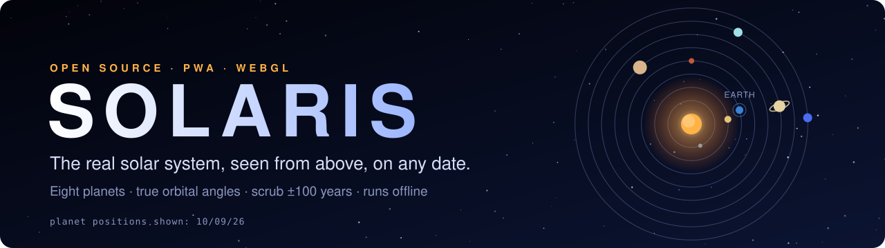
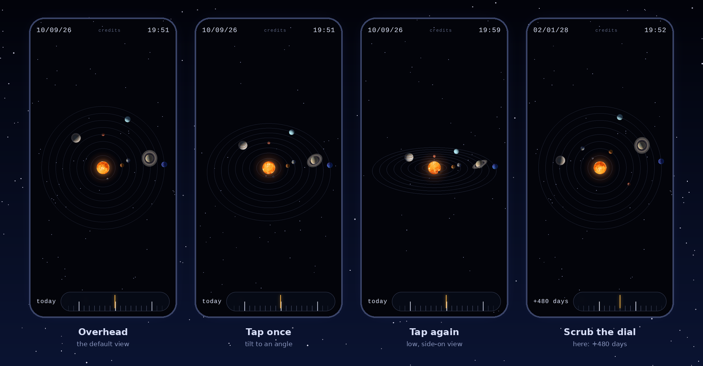
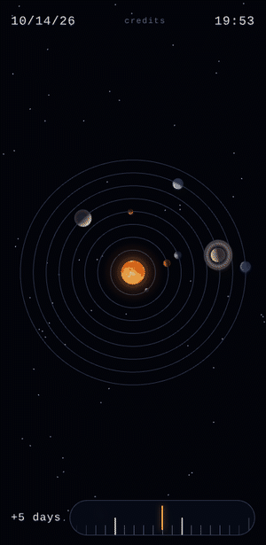
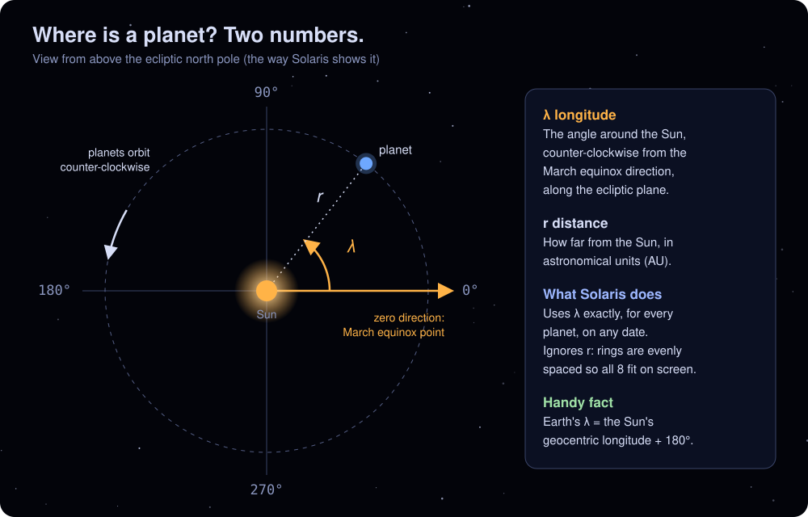
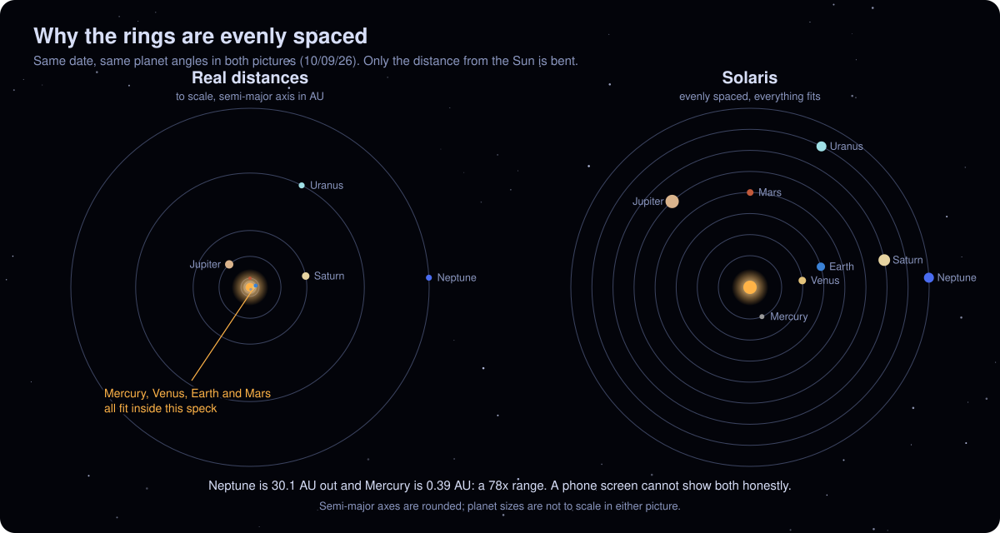
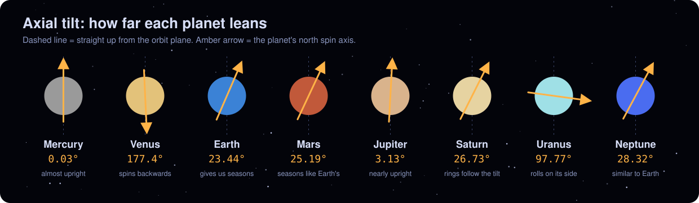
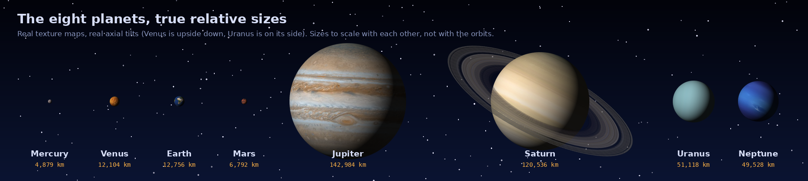
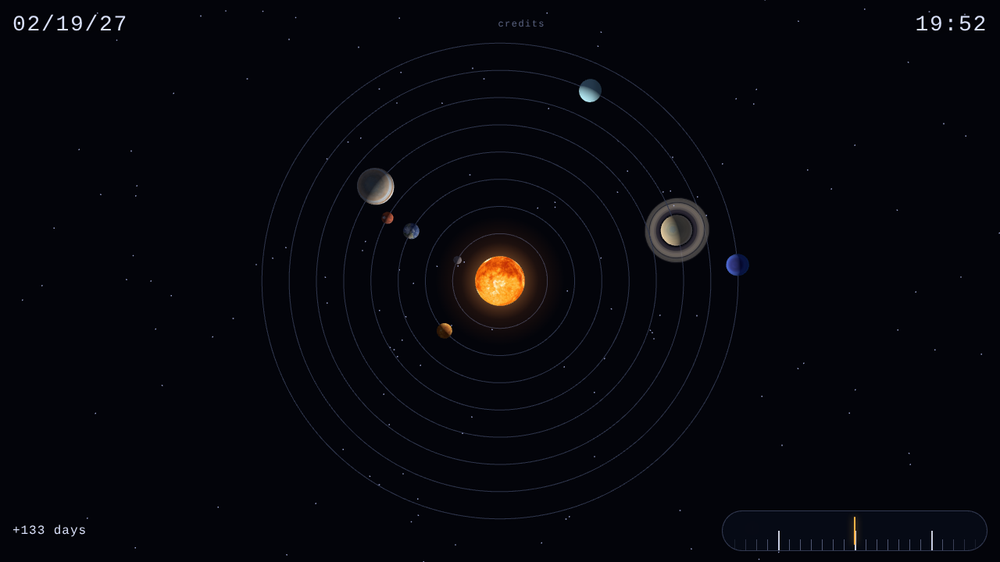
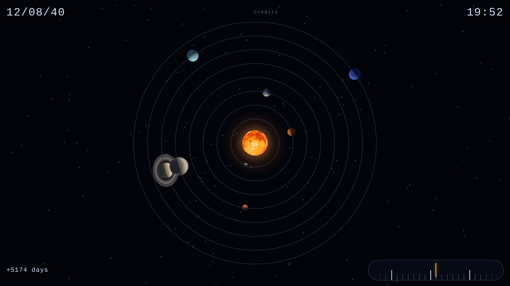
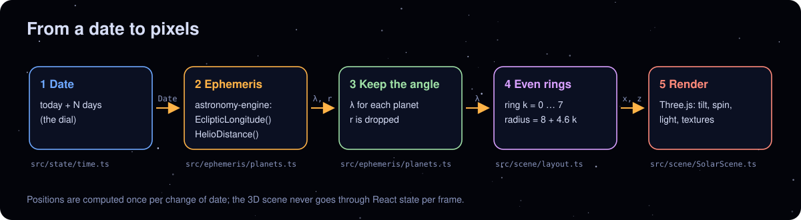

<div align="center">



<br>

[](https://sphereto.github.io/solaris/)


**Scrub through time. Watch the planets move. Check the orbital mechanics yourself.**

<br>



</div>

<br>

## ✦ Contents

| | |
|---|---|
| 🌌 [What is Solaris?](#what) | 🧪 [Experiments to try](#experiments) |
| 🎬 [See it move](#demo) | ⚙️ [How it works](#how) |
| 🕹️ [Controls and install](#controls) | 🎯 [What is real, what is not](#honest) |
| 🔭 [The science in five minutes](#science) | 🗺️ [Roadmap](#roadmap) |
| 📋 [The planets at a glance](#planets) | 📖 [Glossary](#glossary) |
| 🛠️ [Run it yourself](#develop) | 📜 [License and credits](#credits) |
| 🛰️ [Discover: NASA pictures and data](#discover) | ⚙️ [Settings](#settings) |

<a id="what"></a>
## 🌌 What is Solaris?

Solaris is a small, open-source, **top-down model of the solar system** that runs in your browser or as an installed app on your phone.

- The **Sun** sits in the middle with **eight orbit rings** around it.
- Each ring carries its planet, drawn as a **textured 3D sphere** with its real axial tilt, spinning.
- Every planet sits at the **angle it really has around the Sun** on the date you choose.
- A **dial** moves you through time, about 100 years in either direction.

It is made for people who like orbital mechanics: students meeting Kepler for the first time, amateur astronomers who want to *see* an opposition coming, and anyone who has wondered where Neptune is right now.

> [!NOTE]
> Solaris is an **instrument for building intuition**, not an observing tool. It shows the system as seen from the Sun, not from Earth, and it bends the distances so everything fits on a phone. [What is real, what is not](#honest) spells out exactly where.

<a id="demo"></a>
## 🎬 See it move

<div align="center">



*About 300 days in 5 seconds. Mercury laps the Sun three times while Earth gets most of the way round once.*

</div>

<a id="controls"></a>
## 🕹️ Controls and install

| Do this | And this happens |
|---|---|
| **Tap a planet** | The camera zooms in. The planet fills the bottom of the screen (or the left on wide screens), spins, and its name, distance and day and year lengths appear beside it |
| **Swipe** (or **← / →**) while zoomed in | Next or previous planet. **Esc** or the back button returns to the solar system |
| **Tap** empty space | Tilts the camera: overhead → angled → low → back to overhead |
| **Double-tap** the view | Straight back to overhead |
| **Drag the dial** | Drag **left** to go forward in time, **right** to go back. A faster drag covers more days per pixel |
| **Mouse wheel** | Scroll down moves forward in time |
| **← / →** (or ↓ / ↑) | One day back or forward. **Shift** = 30 days, **Alt** = 365 days |
| **Home** | Back to today |
| **Tap the day counter** (bottom left) | Back to today |
| **Discover more** (above the dial, right) | Opens live NASA pictures and data |
| **Settings button** (next to it) | Opens every setting: effects, motion, time, NASA key, units |

**Reading the screen**

```
 MM/DD/YY                                      HH:MM
 the date you are viewing                 your live clock

                  ( the 3D view )

 +120 days                              [ ◄  dial  ► ]
 offset from today
```

The date at the top left and the `+N days` counter always agree. The clock at the top right is your real time and does not change as you scrub.

**Install it as an app.** Solaris is a Progressive Web App, so it can live on your home screen and works offline after the first visit.

| Where | How |
|---|---|
| Android (Chrome) | ⋮ menu → **Install app** or **Add to Home screen** |
| iPhone / iPad (Safari) | Share button → **Add to Home Screen** |
| Desktop (Chrome, Edge) | Install icon at the right end of the address bar |

<a id="science"></a>
## 🔭 The science in five minutes

### Where is a planet? Two numbers

<div align="center">

</div>

To place a planet in a flat, top-down picture you need only its **heliocentric ecliptic longitude** (λ, the angle around the Sun) and its **distance** (r). Solaris takes λ from the [Astronomy Engine](https://github.com/cosinekitty/astronomy) library for every planet and every date.

The library measures λ **prograde** (the direction of Earth's orbit), from the **true equinox of date**. Seen from above the north pole, that is counter-clockwise, with 0° to the right and 90° at the top of your screen.

> [!TIP]
> Because the zero direction is the equinox, you can read the seasons straight off the screen. See [experiment 3](#exp3).

### Kepler's three laws, and where you can see them

| Law | In plain words | Where to look in Solaris |
|---|---|---|
| **1. Ellipses** | Orbits are ellipses with the Sun at one focus. | Orbits here are drawn as circles (see [limitations](#honest)), but the *angles* come from the real elliptical motion. |
| **2. Equal areas** | A planet sweeps equal areas in equal times, so it moves faster when closer to the Sun. | Earth moves **1.0195°/day** at perihelion (3 Jan 2027) and **0.9538°/day** at aphelion (5 Jul 2027). Mercury's speed ranges from **2.74 to 6.32°/day** over one orbit. |
| **3. Harmonic law** | The square of the orbital period is proportional to the cube of the orbit size: **P² = a³** (years, AU). | Check it with the table below. |

**P² = a³, checked** (a in AU, P in years; the two columns should match):

| Planet | a | a³ | P | P² |
|---|---:|---:|---:|---:|
| Earth | 1.000 | 1.00 | 1.000 | 1.00 |
| Mars | 1.524 | 3.54 | 1.881 | 3.54 |
| Jupiter | 5.203 | 140.9 | 11.86 | 140.7 |
| Neptune | 30.1 | 27,271 | 164.8 | 27,159 |

### Why are the rings evenly spaced?

<div align="center">

</div>

Neptune orbits at about 30 AU and Mercury at 0.39 AU, a **78×** spread. At true scale on a phone screen, the four inner planets would sit inside a speck around the Sun.

So Solaris keeps **what matters for the picture of motion, the angle**, and bends **the distance**. Both pictures above show the same date and the same angles. Only the ring spacing differs.

### Axial tilt

<div align="center">

</div>

Each planet in the 3D view leans by its real **obliquity** (axial tilt). That is why Uranus rolls on its side and Venus spins backwards, and why Earth's 23.4° lean, not its distance from the Sun, gives us seasons.

### How big are they, really?

<div align="center">


*Sizes are to scale with each other. Inside Solaris the planets are drawn far larger relative to their orbits, so you can see them at all.*
</div>

<a id="planets"></a>
## 📋 The planets at a glance

| Ring | Planet | Orbit size *a* (AU) | Year (orbital period) | Axial tilt | Day (rotation) |
|:---:|---|---:|---:|---:|---:|
| 1 | **Mercury** | 0.39 | 88.0 days | 0.03° | 58.6 days |
| 2 | **Venus** | 0.72 | 224.7 days | 177.4° | 243.0 days, **retrograde** |
| 3 | **Earth** 🌍 | 1.00 | 365.26 days | 23.44° | 23.93 h |
| 4 | **Mars** | 1.52 | 687.0 days | 25.19° | 24.62 h |
| 5 | **Jupiter** | 5.20 | 11.86 years | 3.13° | 9.93 h |
| 6 | **Saturn** 🪐 | 9.5 | 29.46 years | 26.73° | 10.66 h |
| 7 | **Uranus** | 19.2 | 84.0 years | 97.77° | 17.24 h, **retrograde** |
| 8 | **Neptune** | 30.1 | 164.8 years | 28.32° | 16.11 h |

Orbit sizes are rounded semi-major axes. The orbital periods of Mercury, Venus, Earth and Mars were also recomputed from Astronomy Engine while writing this page (88.0, 224.8, 365.3 and 687.0 days).

<a id="experiments"></a>
## 🧪 Experiments to try

Each one tells you the **date to look for**. Scrub until the date readout at the top left shows it. The `+N days` figures are for **10/09/26**, when the screenshots were taken, so use the date readout rather than the day count if you are reading later.

> [!NOTE]
> The dates below were computed with the same library the app uses. Alignment dates are when two planets share the same angle around the Sun, so they are **views from the Sun**, not the sky as seen from Earth.

### 1. Catch a Mars opposition: `02/19/27` (+133 days)

<div align="center">

</div>

Earth and Mars share the same angle (within about 0.05°), so the Sun, Earth and Mars form one line with **Earth in the middle**. That is an **opposition**: Mars is as close as it gets and visible all night.

- Earth is about **0.99 AU** from the Sun and Mars about **1.67 AU**, so they are roughly **0.68 AU (about 100 million km)** apart.
- The previous alignment was `01/16/25`. The gap between them is **765 days**.
- **Why 765, not the textbook 780?** The synodic period, 1 / (1/1 − 1/1.881) ≈ **780 days**, is an *average*. Mars's orbit is noticeably eccentric, so real gaps vary.

### 2. Jupiter and Saturn, from the Sun: `11/02/20` and `12/08/40`

<div align="center">

</div>

Jupiter and Saturn share an angle around the Sun on **11/02/20**, and again on **12/08/40** (about 14 years after 10/09/26, which is +5,174 days).

> [!IMPORTANT]
> You may remember the **great conjunction of 21 December 2020**, when the two planets looked almost touching in Earth's sky. That date is **different** from the Sun-view alignment above. Same two planets, two different vantage points, two different dates. Conjunction depends on *where you stand*.

### 3. Read the seasons off the screen <a id="exp3"></a>

Earth's longitude hits the four cardinal points exactly at the equinoxes and solstices (values measured from the library):

| Event (2027) | Date | Earth's λ | Where Earth sits on screen |
|---|---|:---:|---|
| March equinox | `03/20/27` | 180° | far **left** |
| June solstice | `06/21/27` | 270° | **bottom** |
| September equinox | `09/23/27` | 0° | far **right** |
| December solstice | `12/22/27` | 90° | **top** |

Handy rule: **Earth's λ = the Sun's geocentric longitude + 180°**. At the March equinox the Sun is at 0° as seen from Earth, so Earth is at 180° as seen from the Sun.

### 4. Is Earth closest to the Sun in summer? `01/03/27` vs `07/05/27`

- **Perihelion** (closest): `01/03/27`, **0.9833 AU**
- **Aphelion** (farthest): `07/05/27`, **1.0167 AU**

Earth is closest to the Sun in **January**, during northern winter. The distance only differs by about **3%**, so it is the **axial tilt** (see the tilt chart above) that makes the seasons, not distance.

### 5. A Mercury year lasts 88 days

Scrub forward 88 days and watch Mercury come back to where it started. Now compare speeds on `10/09/26`:

| Planet | Angular speed | 
|---|---:|
| Mercury | **3.02°/day** |
| Neptune | **0.0061°/day** |

Mercury sweeps its angle about **500 times faster** than Neptune. Neptune's *year* is 164.8 Earth years, so the dial's whole 200-year span covers just a bit more than one lap of it. Scrub from one end to the other and you will see Neptune go round once.

### 6. Your own challenge

Find a date when **Earth, Mars and Jupiter** all share roughly the same side of the Sun. Then find one where they are spread out as far as possible. Share your dates in an issue or discussion.

<a id="how"></a>
## ⚙️ How it works

<div align="center">

</div>

**Stack**

| Piece | Choice | Why |
|---|---|---|
| UI | React 19 + TypeScript | Date, clock, counter and dial are ordinary components |
| 3D | three.js (plain, outside React) | The render loop never goes through React state, so scrubbing stays smooth |
| Positions | [Astronomy Engine](https://github.com/cosinekitty/astronomy) | Small, MIT-licensed, documented accuracy of about 1 arcminute |
| Build | Vite + `vite-plugin-pwa` | Installable, offline after first visit |
| Tests | Vitest | The date maths, camera framing and tap handling are all tested |

**Performance, so it runs on modest phones**

- Pixel ratio is capped at 2 and **drops automatically** if frames run slow, then the frame rate is capped near 30 fps. It never climbs back up, to avoid flip-flopping.
- Rendering **pauses completely** when the tab is hidden.
- If the browser reclaims the GPU context, the scene stops and resumes when it is restored.
- Textures are 1024×512 (about 1 MB in total) and are cached after the first load.
- The camera is **tap and double-tap only**: no pinch or orbit gesture to fight the browser.

**Layout**

```
src/ephemeris/   date → planet positions (pure TypeScript, unit tested)
src/scene/       Three.js scene: Sun, rings, planets, camera, tap gestures
src/ui/          HUD: date, clock, day counter, dial, credits
src/state/       the dial's shared state
public/textures/ planet textures (CC BY 4.0, see CREDITS.md)
```

<a id="develop"></a>
## 🛠️ Run it yourself

Needs [Node.js](https://nodejs.org/) (22 is what CI uses) and [pnpm](https://pnpm.io/).

```bash
git clone https://github.com/sphereto/solaris.git
cd solaris
pnpm install
pnpm dev          # local dev server
pnpm test         # unit tests
pnpm typecheck
pnpm build        # production build in dist/
pnpm preview      # serve the production build locally
```

**Deploying your own copy**

- **GitHub Pages:** push to `main`. The `Deploy` workflow builds with `BASE_PATH=/solaris/` and publishes. In *Settings → Pages* set the source to **GitHub Actions** once, and do **not** accept the suggested "Static HTML" or "Jekyll" starter workflow (it would publish your raw source files and show a blank page).
- **Vercel:** import the repo. The defaults work (build `pnpm build`, output `dist`).

<a id="discover"></a>
## 🛰️ Discover: NASA pictures and data

The **Discover more** button above the dial opens a sheet of live NASA material. Most of it follows the date on the dial.

| Tile | What it shows | Follows the dial? | Source |
|---|---|---|---|
| Picture of the day | The day's astronomy picture, in a full-screen viewer | Yes | NASA APOD |
| Earth today | Full-disc Earth pictures from a satellite 1.5 million km away, with a "play the day" button | Yes (nearest day with pictures) | NASA EPIC |
| The Sun now | Live pictures of the Sun and the current storm level | No, always live | NASA SDO and NOAA |
| Asteroids | Close approaches in the 7 days from the dial date, on a distance ruler | Yes | NASA NeoWs |
| Image library | Search NASA's picture archive, optionally limited to the dial's year | Optional | NASA Image Library |
| Exoplanets | Newest, nearest and Earth-sized worlds, with an orbit diagram | By discovery year | NASA Exoplanet Archive |

**Setting up your NASA key**

1. Get a free key at [api.nasa.gov](https://api.nasa.gov/).
2. Easiest: paste it into **Settings → NASA data → Your NASA key** and press **Test**. It stays on that device. Or, for a build, create `.env.local` with `VITE_NASA_API_KEY=your_key`. With neither, the app falls back to NASA's shared `DEMO_KEY`, which runs out quickly.
3. For the deployed site, add a repository secret named `NASA_API_KEY` (*Settings → Secrets and variables → Actions*). The Deploy workflow passes it to the build.

The key is built into the page, so anyone can read it from the deployed site. NASA keys are free and rate limited; do not reuse one that matters.

**Exoplanet data** is downloaded at build time, because the Exoplanet Archive does not allow requests from web pages. Run `pnpm data:exoplanets` (Node 22.18 or newer) and commit `src/data/exoplanets.json`. The Deploy workflow also refreshes it on every deploy and every Monday, and keeps the committed copy if the download fails.

**Not included:** NASA's Mars Rover Photos service no longer exists, and DONKI space weather does not answer browser requests, so neither is used.

<a id="settings"></a>
## ⚙️ Settings

The slider icon next to **Discover more** opens one scrolling page. Every change applies at once and is saved on the device.

| Section | What you can change |
|---|---|
| **Look** | Atmosphere glow around planets · Saturn's ring shadows · twinkling stars and Milky Way · planet labels (off, when tilted, always) · graphics quality (Auto, High, Saver) |
| **Motion** | Planet spin speed · dial speed · start view · tap empty space to tilt · reduce motion |
| **Time** | Date format (MM/DD/YY, DD/MM/YY, YYYY-MM-DD) · 12 or 24 hour clock |
| **NASA data** | Your own NASA key with a **Test** button · kilometres or miles · save data · clear saved pictures |
| **About** | Credits · version · reset everything |

**Graphics quality.** *Auto* lowers the render resolution and then the frame rate when the device struggles, and if it has to cap the frame rate it also stops drawing the ring shadows, Milky Way and twinkling. *High* never lowers anything and allows a sharper picture. *Saver* draws at normal resolution, caps at about 30 frames a second and turns the glow, ring shadows and sky effects off.

**How the extras are drawn.** Atmosphere glow is a soft ring sprite behind each planet. Saturn's ring shadows are computed per pixel: the planet darkens the part of the rings behind it, and the rings darken a band on the planet. The twinkling stars are one draw call. The Milky Way is a texture painted once at start-up.

<a id="honest"></a>
## 🎯 What is real, what is not

| | Status | Detail |
|---|:---:|---|
| Planet **angles** around the Sun | ✅ real | From Astronomy Engine, documented accuracy about **1 arcminute**. On a phone-sized view that is a small fraction of a pixel. |
| Which **date** | ✅ real | Today plus N days at the current time of day, in your local time zone. |
| **Axial tilt** and spin direction | ✅ real | Venus and Uranus really are retrograde rotators. |
| **Textures** | ✅ real imagery | Solar System Scope maps, which they describe as based on NASA data. |
| **Orbit distances** | ❌ not to scale | Rings are evenly spaced, see [above](#science). |
| **Orbit shapes** | ❌ circles | Real orbits are ellipses, and are not drawn as such (the *angles* still include the ellipse's effects). |
| **Planet sizes** | ❌ enlarged | Order is preserved (Jupiter largest, Mercury smallest). |
| **Spin speed** | ❌ compressed | Real periods run from 10 hours to 243 days, which would be a blur or a freeze. Faster real spin still looks faster. |
| **Lighting** | ❌ simplified | The Sun lights the planets, with no falloff with distance, so Neptune stays readable. |
| **Date range** | ⚠️ limited | The dial stops about 100 years either side of today. The library is built for a wider span, but the ends of that range have not been independently validated. |
| **Observing use** | ⚠️ no | This is the view *from the Sun*. It does not show what is in your sky. For that you want a planetarium app or an ephemeris service such as [JPL Horizons](https://ssd.jpl.nasa.gov/horizons.cgi). |

> [!WARNING]
> Do not use Solaris to plan observations or spacecraft work. It is for learning and exploring.

<a id="roadmap"></a>
## 🗺️ Roadmap

- [x] Overhead 3D view with eight textured, tilted, spinning planets
- [x] Date dial with momentum, wheel and keyboard control
- [x] Tap to tilt, double-tap to reset
- [x] Installable and offline-ready
- [x] Discover: NASA pictures, Earth, the Sun, asteroids, image search and exoplanets
- [x] Settings page, atmosphere glow, Saturn's ring shadows, Milky Way, twinkling stars and planet labels
- [ ] Discover: Mars rover photos (needs a new data source)
- [x] Tap a planet to zoom in, with its name, distance and day and year lengths
- [ ] Play / pause time, and jump to a typed date
- [ ] Event finder: next opposition, conjunction, equinox, solstice
- [ ] Planet trails
- [ ] The Moon with its real phase
- [ ] True-scale mode with real elliptical orbits
- [ ] Android app (Trusted Web Activity or Capacitor, decided by a real-device smoothness test)

Ideas and pull requests are welcome.

<a id="glossary"></a>
## 📖 Glossary

<details>
<summary><b>Open the glossary</b></summary>

<br>

| Term | Meaning |
|---|---|
| **AU (astronomical unit)** | The average Earth–Sun distance, about 149.6 million km. |
| **Ecliptic** | The plane of Earth's orbit around the Sun. Most planetary orbits lie close to it. |
| **Heliocentric** | Measured from the Sun's centre. |
| **Ecliptic longitude (λ)** | An angle along the ecliptic, here measured counter-clockwise from the March equinox direction. |
| **Equinox of date** | The March-equinox direction at the date in question. It drifts slowly (precession), roughly 1.4° per century. |
| **Prograde** | In the same direction as the planets orbit. |
| **Retrograde** | The opposite way. Used for a spin direction (Venus, Uranus), or for the apparent backwards drift of a planet in Earth's sky. |
| **Semi-major axis (a)** | Half the long diameter of an elliptical orbit. The "size" of an orbit. |
| **Eccentricity (e)** | How stretched an ellipse is: 0 is a circle. |
| **Perihelion / aphelion** | A planet's closest and farthest points from the Sun. |
| **Axial tilt (obliquity)** | The angle between a planet's spin axis and its orbit's normal. |
| **Sidereal period** | The time to return to the same angle against the stars: the planet's "year". |
| **Synodic period** | The time between repeats of the same alignment of two planets: 1/S = \|1/P₁ − 1/P₂\|. |
| **Opposition** | When a planet is opposite the Sun in Earth's sky, which for an outer planet means Earth lies between it and the Sun. |
| **Conjunction** | When two bodies share the same longitude. Always depends on the viewpoint. |
| **Ephemeris** | A table or program giving positions of bodies over time. |

</details>

<a id="credits"></a>
## 📜 License and credits

**Code:** [MIT](LICENSE) © 2026 sphereto.

**Planet textures:** Copyright © 2010–2017, [Solar System Scope](https://www.solarsystemscope.com/textures), distributed under [CC BY 4.0](https://creativecommons.org/licenses/by/4.0/). The files in `public/textures/` are **not** covered by the MIT license. Solaris resized and re-encoded them, converted the cloud map to grayscale for use as transparency, and cropped the Saturn ring image. Full details are in [CREDITS.md](CREDITS.md).

**Built with:** [Astronomy Engine](https://github.com/cosinekitty/astronomy) by Don Cross (MIT), [three.js](https://threejs.org/) (MIT), [React](https://react.dev/) (MIT), [Vite](https://vite.dev/) (MIT).

**Further reading:** NASA JPL's [Approximate Positions of the Planets](https://ssd.jpl.nasa.gov/planets/approx_pos.html) explains the simpler Keplerian method, and [JPL Horizons](https://ssd.jpl.nasa.gov/horizons.cgi) is the high-precision ephemeris service.

<br>

<div align="center">

**☀️ &nbsp; Made for anyone who ever looked up and wondered where everything is. &nbsp; ☀️**

</div>
